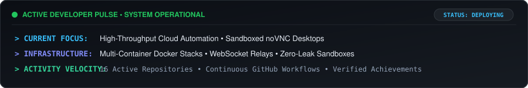

# Sahil Tandon
### Cybersecurity Engineer & Infrastructure Automation Specialist

  

<!-- Live Pulse HUD -->

  

---

### 👨‍💻 About Me

> ### 🎯 Core Engineering Philosophy
> Focused on **cybersecurity**, **automation engineering**, **networking**, and **high-availability IT systems**.
> 
> My work combines advanced **Python-based automation** with deep **system troubleshooting**, **security auditing**, and **cloud infrastructure**. I specialize in building practical technical solutions that emphasize operational security, real-time network visibility, digital forensics, and autonomous containerized environments.
> 
> Whether architecting low-level protocol relays, hardening cloud deployments on Render & Railway, or orchestrating sandboxed virtual desktops with zero memory overhead, my objective is delivering **scalable, resilient, and secure systems**.

 

### 🔎 Core Areas of Focus

<table>
  <tr>
    <td width="50%" valign="top">
      <h4>🛡️ Cybersecurity &amp; Security Monitoring</h4>
      
Threat intelligence, SIEM log analysis with Splunk, anomaly detection, and vulnerability mitigation.

    </td>
    <td width="50%" valign="top">
      <h4>🌐 Network Analysis &amp; Troubleshooting</h4>
      
Packet-level inspection via Wireshark, traffic flow forensics, socket engineering, and protocol routing.

    </td>
  </tr>
  <tr>
    <td width="50%" valign="top">
      <h4>⚡ Python &amp; Systems Automation</h4>
      
Robust CLI automation, process supervisors, multi-threaded pipelines, and asynchronous API integrations.

    </td>
    <td width="50%" valign="top">
      <h4>🤖 Browser &amp; Desktop Virtualization</h4>
      
Headless automation, containerized noVNC cloud desktops, and anti-detection engines.

    </td>
  </tr>
  <tr>
    <td width="50%" valign="top">
      <h4>🔍 Digital Forensics Fundamentals</h4>
      
Artifact recovery, security incident triage, system telemetry analysis, and compliance checks.

    </td>
    <td width="50%" valign="top">
      <h4>🐧 Linux &amp; IT Infrastructure</h4>
      
Kernel optimization, daemon supervision, automated recovery loops, and cloud containerization.

    </td>
  </tr>
</table>

---

### ⚡ Technical Arsenal & Core Stack

  

  
  &nbsp;
  
  &nbsp;
  

---

### 🏆 Verified Achievements & Milestones

  

---

### 📬 Direct Communications

  
  &nbsp;
  

Security • Automation • Systems • Continuous Learning

