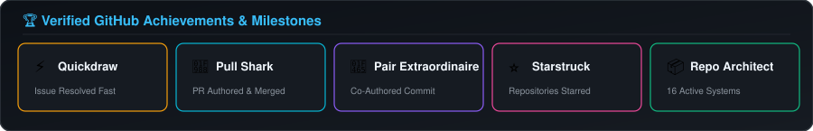
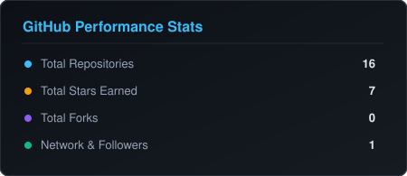
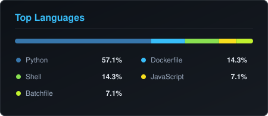

# Sahil Tandon
### Cybersecurity Engineer & Infrastructure Automation Specialist

  

<!-- Live Pulse HUD -->

  

---

### ⚡ Technical Arsenal & Core Stack

  

  
  &nbsp;
  
  &nbsp;
  

---

### 🏆 Verified Achievements & Milestones

  

---

### 📈 Activity & Development Velocity

  

 

  
  &nbsp;
  

 

  

---

### 📬 Direct Communications

  
  &nbsp;
  

Active systems engineering • Continuous integration &amp; security analysis

