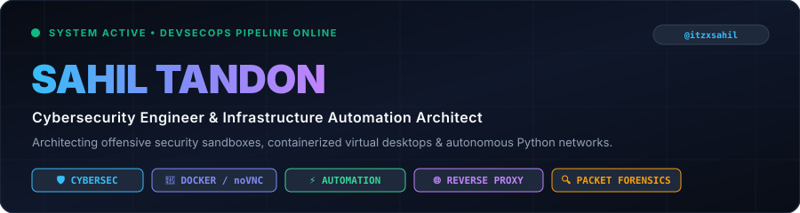
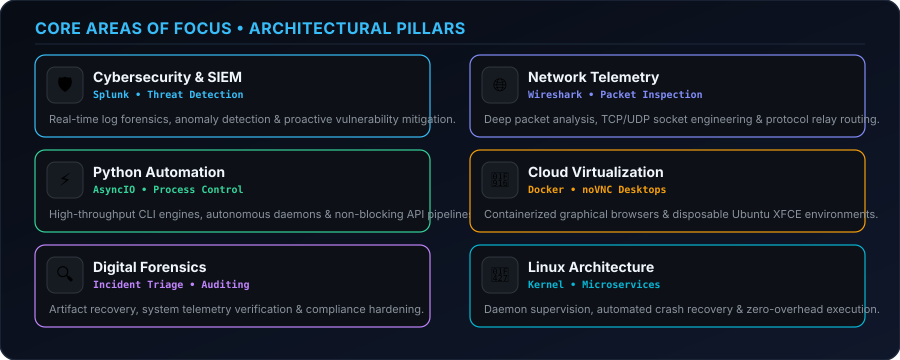

<!-- Hero Banner Card -->

  

  

---

### 👨‍💻 Engineering Overview

> Focused on **cybersecurity**, **automation engineering**, **networking**, and **high-availability IT systems**.
> 
> My work combines advanced **Python-based automation** with deep **system troubleshooting, security auditing, and cloud infrastructure**. I specialize in building practical technical solutions that emphasize operational security, real-time network visibility, digital forensics, and autonomous containerized environments.
> 
> Whether architecting low-level protocol relays, hardening cloud deployments on Render & Railway, or orchestrating sandboxed virtual desktops with zero memory overhead, my objective is delivering **scalable, resilient, and secure systems**.

 

<!-- Core Focus Vector Dashboard -->

  

---

### ⚡ Technical Arsenal & Core Stack

  

  
  &nbsp;
  
  &nbsp;
  

---

### 🏆 Verified Achievements & Milestones

  

---

### 📬 Direct Communications

  
  &nbsp;
  

Security • Automation • Systems • Continuous Learning

